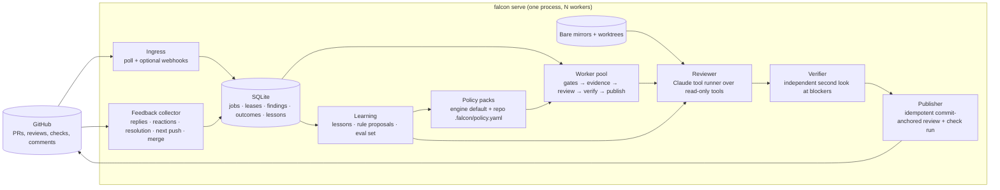

# Falcon v2: PR review engine design

A ground-up replacement for the current agent, built around four primitives: rules the team configures, scale to hundreds of concurrent PRs without losing quality, daily reliability people can trust, and learning from feedback. The scaffold lives in [`v2/`](../v2/).

## Decisions

| Decision | Choice | Why |
| --- | --- | --- |
| Identity | A **GitHub App** ("Falcon review"), not a person | Reviews post as the app, tokens rotate automatically, no laptop or personal grant, auditable, installable per repository, survives offboarding. |
| Trigger | **GitHub events** (poll by default, webhooks optional) | PR opened, synchronize, ready-for-review and `/falcon review` comments already exist. Google Chat becomes an optional notifier, not the request channel. Polling needs no inbound URL, which suits a Mac behind NAT. |
| Language and runtime | **TypeScript on Node 22**, no native dependencies | Built-in SQLite (`node:sqlite`) and type stripping; first-class Anthropic and Octokit SDKs; one process runs under launchd on a Mac or in a container with zero code change. |
| Model | **Claude Opus 5.5** through the Anthropic SDK tool runner; verifier on the same model; Haiku 5.5 for lesson extraction | Adaptive thinking, structured outputs, prompt caching, server-side refusal fallback. The reviewer calls read-only tools over a git checkout instead of receiving a 1 MB blob, so each PR costs one git fetch and a few dozen targeted reads. |
| Evidence | **git**, not REST per file | One bare mirror per repository, a detached worktree per job at the PR head, local diff against the merge base. Hundreds of REST calls per PR become about six. |
| Verdict | **Comment plus check run by default**; approve or request-changes only where the repository's policy says so | Approval authority is a team decision made in a reviewed policy file, not an engine default. |
| State | **SQLite with leases** | Crash-only: a worker that dies loses its lease and another picks the job up. Hundreds of PRs per day fit one host; the store is behind an interface if Postgres is ever needed. |

## Architecture



### Request lifecycle

1. **Ingress** normalizes a PR event into `ReviewRequest{repo, number, headSha, baseSha, trigger}` and enqueues it. Idempotency key is `(repo, number, head)`; a newer head cancels older unpublished jobs for the same PR.
2. **Scheduler** leases jobs to workers with per-repository and global caps. Leases expire; heartbeats extend them. Priority then age.
3. **Gates** before any tokens: closed, merged, draft, bot author, already reviewed at this head, CI pending (requeue) or failed (hold).
4. **Evidence**: fetch `refs/pull/N/head` and the base into the mirror, compute the merge base and the diff, create a worktree at the head. The diff parser produces the exact set of lines GitHub will accept as inline anchors (RIGHT for added or context lines, LEFT only for deletions).
5. **Policy**: engine pack merged with the repository's `.falcon/policy.yaml` at the head. Scope excludes lockfiles and generated code; rules, standards and suppressions are rendered into the reviewer's cached system prompt. The central pack sets `verdict.maxMode`, the most authority any repository may opt into (comment, request_changes or approve); a repository picks its mode up to that ceiling and cannot raise the ceiling.
6. **Review**: Claude reads the diff and the repository through five read-only tools (`read_file`, `list_dir`, `search`, `show_diff`, `git_history`) and ends by calling `submit_review`. The host validates every finding against the worktree (file exists, line exists, quoted evidence is on that line) and rejects the submission with reasons until it is clean. Budgets: tool calls, minutes, file size.
7. **Verify**: each blocking finding gets an independent second look with only the surrounding source in view. A verifier "no" demotes it to non-blocking and says why in the comment.
8. **Publish**: one review per head, body carries a marker, inline comments carry finding ids. If GitHub rejects an anchor, the review is reposted body-only rather than lost. A check run ("Falcon review") exposes the result to branch protection without the bot approving as a person.
9. **Feedback**: thumbs up or down on a comment, replies ("not a bug", "fixed"), `/falcon wrong <id>`, thread resolution, the cited line changing on the next push, or the PR merging with the finding untouched. Each becomes an outcome row keyed by the finding's stable fingerprint.
10. **Learning**: see below.

## The four primitives

### Rules the team configures

A policy pack is YAML in git, reviewed like code. Example repository overlay:

```yaml
version: 1
name: launch-engineering
scope:
  exclude: ["Orbit/legacy/**"]
verdict:
  mode: request_changes      # comment | request_changes | approve
  blockOn: [critical, high]
context:
  required: ["Orbit/CLAUDE.md"]
standards:
  - title: Admin UI stack
    paths: ["src/UI/MP.UI.Web.Admin/**"]
    text: ES6 with Aurelia 1.x, NLog, and the documented SQL conventions. React or TypeScript rules do not apply here.
rules:
  - id: feature-flag-default
    title: New behavior ships behind a flag defaulting off
    severity: high
    paths: ["src/Services/**"]
    guidance: Any new code path reachable in production must be gated by a flag whose default is off.
    examples:
      - bad: "if (newPricing) …   // flag defaults to true"
        good: "if (flags.isEnabled('new-pricing')) …  // default false"
suppressions:
  - rule: error-handling
    paths: ["tools/scripts/**"]
    reason: one-off operator scripts fail loudly by design
```

Prose guidance is applied by the model; scope, severities, blocking and suppressions are enforced by the host after the model answers. The model cannot talk its way past a suppression or into an approval.

### Hundreds of concurrent PRs

Throughput is bounded by model rate limits, not by the engine. A review is one git fetch, a few GitHub calls, and typically 20 to 40 tool calls; wall time is a few minutes. With 8 to 20 workers that is hundreds of PRs per hour on one host. Quality is protected by budgets per review rather than by serializing reviews: when rate-limited, the engine waits; it never trims evidence to fit. Per-repository caps stop one busy repository from starving others. Git mirrors make repeat PRs on the same repository nearly free to fetch.

### Reliability and trust

- Crash-only: every step records state in SQLite; leases recover crashed work with attempts counted; transient errors (429, 5xx, network) requeue with backoff; permanent ones hold with the reason stored.
- Deterministic host checks: nothing unverifiable is posted; the host picks the event; the marker makes re-posting impossible.
- Dry run first: `falcon review <pr-url>` prints exactly what would be posted without posting. Policy authors iterate with it.
- Verifier pass on blockers cuts false positives before anything blocks a merge.
- Every finding has an id a human can address: `/falcon why <id>`, `/falcon wrong <id>`.
- Structured logs, usage per job, queue counts, and an alert webhook for stalled queues or auth failures (serve-level work still to add).

### Learning from feedback

Three layers, all visible, none silent:

1. **Lessons.** A corrective outcome (thumbs down, "not a bug", merged unaddressed) is turned by a small model call into one reusable, repository-scoped lesson with a path prefix and a confidence. Lessons are stored, deduplicated, bounded per prompt, and injected into the reviewer's system prompt for that repository. They outrank the model's priors but never the verified source.
2. **Rule proposals.** Recurring rejected patterns are clustered into a proposed policy-pack change, opened as a PR against the policy file. A human merges it. The engine's behavior changes only through reviewed git history.
3. **Eval set.** Every finding with an outcome is a labeled case. `falcon eval` (next phase) replays sampled PRs at their fixed heads with the current policy, prompt and model, and reports precision and recall before a change ships.

## Operations: metrics, queue visibility, limits

**Limits** live in two places with a clear precedence. The engine config (`falcon.yaml`, operator-owned) sets hard ceilings; a repository's policy pack sets budgets that are clamped to those ceilings. A repository can spend less than the ceiling, never more.

| Limit | Where | Default | Behavior when hit |
| --- | --- | --- | --- |
| Tool calls per review | policy `budgets.maxToolCalls`, ceiling `limits.perReview.maxToolCalls` | 80 / 120 | Tools return "budget exhausted, submit now"; the model must submit what it has verified. |
| Minutes per review | policy `budgets.maxMinutes`, ceiling `limits.perReview.maxMinutes` | 25 / 30 | Review aborted and held with the reason. |
| Input and output tokens per review | policy `budgets.maxInputTokens` / `maxOutputTokens`, ceilings in `limits.perReview` | 800k, 60k / 1.5M, 150k | Checked after every model call; aborted and held with the reason. |
| Dollars per review | policy `budgets.maxCostUsd`, ceiling `limits.perReview.maxCostUsd` | $6 / $15 | Estimated from list prices after every call; aborted and held with the reason. |
| Dollars per repository per UTC day | `limits.daily.perRepoUsd` | $200 | New reviews for that repository defer to the next day; nothing fails. |
| Dollars globally per UTC day | `limits.daily.globalUsd` | $1000 | All new reviews defer to the next day. |
| Changed files per review | policy `budgets.maxChangedFiles` | 300 | Held with the reason. |
| Concurrent reviews | `workers.concurrency`, `workers.perRepoConcurrency` | 8, 4 | Jobs wait in the queue. |

Cost is estimated from a per-model price table in `src/pricing.ts` (overridable); every job stores its tokens and estimated dollars, so `spend today` on the dashboard and the daily caps come from the same numbers.

**Metrics** are exposed at `/metrics` in Prometheus text format, which the Datadog agent scrapes as OpenMetrics. Counters: jobs finished by outcome, reviews published by event, findings by severity and blocking, feedback signals, tokens by kind, estimated spend, errors by component, deferrals by reason. Histograms: review duration, queue wait before first lease, tool calls per review. Gauges computed from SQLite at scrape time: jobs by status, live jobs by repository, age of the oldest runnable job, spend today. The useful alerts are oldest-queued-age, error rate, spend-today near cap, and no published review in N hours while jobs are queued.

**Queue visibility**: `/` is a plain HTML dashboard (counts, by-repository table, what is in review and on which worker, recent jobs with wall time and cost and the hold reason). `/api/queue`, `/api/jobs`, `/api/jobs/:id` return the same as JSON, the last one with the job's usage and full event trail. `falcon status`, `falcon jobs`, `falcon job <id>` print the same from the command line. The server binds to localhost by default and is read-only.

## Data model

`jobs` (lease, attempts, status, result), `events` (audit trail), `findings` (stable fingerprint, GitHub comment id), `finding_outcomes` (signal, actor), `reviews` (GitHub review and check-run ids, marker), `usage` (tokens, estimated cost and wall time per job, by repository and time for the daily caps), `lessons`, `cursors` (poll position per repository). All in one SQLite file under the state directory.

## Deployment on a dedicated Mac

The runbook is [`v2/deploy/MAC.md`](../v2/deploy/MAC.md) and the installer is `v2/deploy/install-mac.sh`. One Node process, `falcon serve`, under a launchd agent with `KeepAlive`; each review in a child process with a hard deadline; `dryRun: true` for the first week. State in `~/Library/Application Support/falcon`. Secrets as environment variables injected by the launch agent from the Keychain or a secrets manager: the GitHub App private key, the Anthropic API key, optionally a webhook secret and a notification webhook. Polling needs no inbound port; if webhooks are wanted later, a Cloudflare Tunnel or Tailscale Funnel in front of the webhook port works. A Dockerfile for a container host is a one-day addition because nothing in the engine is macOS-specific.

## Migration

| Phase | Deliverable | Exit test |
| --- | --- | --- |
| 0 (this scaffold) | Engine core, dry-run CLI, default policy, tests | `falcon review <url>` on real launch-engineering PRs produces reviews the team agrees with, side by side with the current agent. |
| 1 | GitHub App registered and installed on one repository; `falcon serve` on the fleet Mac in comment mode | A week of real PRs with no missed or duplicated reviews and no manual restarts. |
| 2 | Feedback collection live; lessons injected; eval set accumulating | Measured false-positive rate falls week over week. |
| 3 | Repository policy packs; teams that want it opt into request-changes or approve mode; rule proposals as PRs | Teams own their policies; the old agent is retired. |

## Relationship to OP3 Investigator

The capability-by-capability comparison, what was closed and what remains, is [gap-analysis-vs-op3-investigator.md](gap-analysis-vs-op3-investigator.md).

The OP3 team runs a production review bot with the same shape: GitHub App identity, host-prepared immutable evidence, a sandboxed Claude run, a host-validated result contract with gates and confidence, Postgres leases, Kubernetes Job per review, Datadog metrics. It is hard-wired to `ROKT/op3` and OP3's policy, so launch-engineering cannot onboard without them generalizing it. Details and recommendation: [op3-investigator-assessment.md](op3-investigator-assessment.md).

Falcon v2 aligns with its proven rules so a later merge is a tenant, not a rewrite:

- A reviewer confidence of `high` or `medium` is part of the result. Medium is always comment-only, whatever the policy mode allows, and the review says so.
- PRs above `budgets.maxChangedLines` (default 750 additions plus deletions in scope) are asked to split rather than reviewed unreliably.
- Comment-only reviews carry a notice that they do not withdraw earlier approvals or change requests.
- Publication parks for operator replay with the finding retained, instead of discarding a finished review (next).
- Alerts page on sustained stall (oldest queued age, no completion in a window), never on one failed job.

## Open decisions

1. Keep Google Chat as a notifier (summary posted to a space via an incoming webhook), or drop it and rely on GitHub notifications? OP3 Investigator keeps the space as both intake and summary channel through a Chat app identity, and people use it heavily.
6. Open the multi-tenant conversation with `@ROKT/op3` now, so Falcon v2 can become launch-engineering's policy and eval set inside their service later?
2. Drop STAMP entirely? The design has no approve-without-review path; if one is needed it should be a labeled, audited GitHub action, not a chat phrase.
3. Where do policy packs live: a central `ROKT/falcon-policy` repository with per-repository overlays, or only in each repository?
4. Initial repository set and the model budget per review.
5. Secrets management on the fleet Mac.

## What exists now and what is next

Implemented and tested in `v2/`: trusted policy from the base branch; retained reviews with publication retry, parking and `falcon replay`; in-progress and completion check runs with hold reasons; redaction and size bounds; per-review tool-call trail; child-process isolation per review; daemon dry-run mode; stall, spend and failure alerts to a webhook; GitHub throttling; Mac launchd installer; per-review token, dollar, time and tool-call limits with operator ceilings; daily spend caps; Prometheus metrics; status server with HTML dashboard and JSON API; CLI status, jobs and job detail; domain types; policy schema, loader, merge and enforcement; SQLite store with idempotent enqueue, lease-based claiming, outcomes and lessons; git mirror, worktree, diff parser and anchor set; host-side finding validation; the reviewer's tool surface and Claude invocation with verifier; review rendering; GitHub publishing with the 422 fallback and check runs; polling ingress; feedback classification; lesson derivation; the worker; a CLI with dry run; a daemon loop.

Next: webhook receiver, reactions and resolution poller, the "line changed on next push" detector, alerting, `falcon eval`, rule-proposal generation, launchd plist and Dockerfile, and an end-to-end dry run against real PRs once an Anthropic key and the GitHub App exist.
